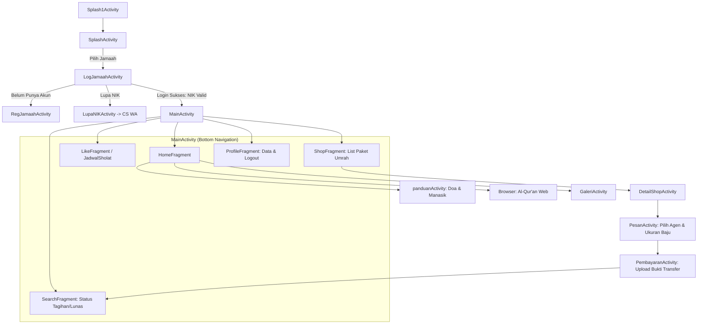

# Laporan Analisis Proyek: Juragan (BottomNavigation)

Dokumen ini berisi analisis menyeluruh terhadap arsitektur, fitur, teknologi, kualitas kode, celah keamanan, dan keandalan sistem aplikasi Android **Juragan** (nama paket: `com.cadenza.bottomnavigation`).

---

## 1. Ringkasan Eksekutif

| Parameter | Keterangan |
| :--- | :--- |
| **Nama Proyek** | Juragan Travel / BottomNavigation |
| **Package Name** | `com.cadenza.bottomnavigation` |
| **Platform** | Android (Native Java) |
| **Bahasa Pemrograman** | Java 8 |
| **Build System** | Gradle 8.0, Android Gradle Plugin 8.1.1 |
| **SDK Support** | `minSdk: 22` (Android 5.1 Lollipop), `targetSdk: 32` (Android 12L), `compileSdk: 34` (Android 14) |
| **Target Pengguna** | 1. Jamaah Umrah & Haji<br>2. Agen Pemasaran Travel |
| **Backend Terhubung** | PHP Native + MySQL (`juragandb`) pada web server intranet (`10.10.176.166`) |
| **Status Pengembangan** | *Prototype to Mid-Development* (Beberapa modul aktif, sebagian modul agen masih placeholder, dan terdapat beberapa bug kritis). |

---

## 2. Struktur Proyek & Organisasi Kode

Struktur direktori utama kode sumber terletak di `app/src/main/java/com/cadenza/bottomnavigation/`:

```
com.cadenza.bottomnavigation/
│
├── AGEN/                         # Modul khusus untuk pengguna peran Agen
│   ├── BerandaFragment.java      # Beranda agen (masih placeholder)
│   ├── DataPribadiFragment.java  # Informasi akun & logout agen
│   ├── HomeAgenActivity.java     # Container navigasi utama Agen
│   ├── LogAgenActivity.java      # Login akun agen
│   ├── LupaPwAgenActivity.java   # Bantuan lupa password agen (redirect WA)
│   ├── NamaJamaahFragment.java   # Daftar jamaah binaan (placeholder)
│   └── TargetJamaahFragment.java # Target capaian jamaah (placeholder)
│
├── API/                          # Konfigurasi komunikasi backend
│   └── Db_Contract.java          # Daftar konstanta IP dan URL endpoint PHP
│
├── Panduan/                      # Modul edukasi ibadah Haji & Umrah
│   ├── panduanActivity.java      # Menu katalog panduan & doa manasik
│   ├── GaleriActivity.java       # Galeri foto kegiatan manasik/travel
│   ├── HukumIbadahHajiActivity.java
│   ├── HukumIbadahUmrohActivity.java
│   ├── NiatIhramActivity.java / NiatUmrohActivity.java
│   ├── DoaArafahActivity.java / DoaSaiActivity.java / DoaTahallulActivity.java
│   ├── DoaMasukMasjidilActivity.java / DoaMemasukiActivity.java
│   ├── DoaSetelahMemakaiActivity.java / DoaKembaliKerumahActivity.java
│   ├── MelemparJumrohActivity.java / TawafIfadahActivity.java / TalbiyahActivity.java
│
├── Tanya/                        # Modul FAQ & Pusat Bantuan
│   ├── TanyaActivity.java        # Menu FAQ populer
│   ├── AkomodasiActivity.java    # Informasi hotel & transportasi
│   ├── CaraActivity.java         # Alur pendaftaran & pemesanan
│   ├── HubungiActivity.java      # Kontak resmi CS
│   ├── JadwalActivity.java       # Jadwal keberangkatan
│   ├── PengembalianActivity.java # Kebijakan refund
│   ├── PersiapanActivity.java    # Persiapan dokumen & fisik
│   └── TotalActivity.java        # Rincian biaya paket
│
├── adapter/                      # Komponen RecyclerView Adapter
│   └── PemesananAdapter.java     # Adapter katalog paket travel (Shop)
│
├── model/                        # Data Transfer Object (POJO)
│   └── PemesananModel.java       # Model data paket umrah
│
├── networking/                   # Utilitas HTTP Background Threading
│   ├── ClientAsyncTask.java      # AsyncTask untuk consume REST API publik
│   └── DaftarKota.java           # Model mapping kota jadwal sholat
│
├── DatabaseHelper.java           # SQLiteOpenHelper lokal (Unused/Legacy)
├── DetailShopActivity.java       # Detail spesifikasi paket travel terpilih
├── HomeFragment.java             # Dashboard beranda Jamaah
├── JadwalSholat.java             # Jadwal sholat 5 waktu dinamis (Bang Hasan API)
├── LikeFragment.java             # Fragment favorit / jadwal sholat statis (Unfinished)
├── LogJamaahActivity.java        # Login Jamaah berbasis NIK
├── LupaNIKActivity.java          # Layanan lupa NIK Jamaah (redirect WA)
├── MainActivity.java             # Container navigasi utama Jamaah
├── PembayaranActivity.java       # Upload bukti transfer & konfirmasi pesanan
├── PesanActivity.java            # Form konfigurasi pemesanan paket & agen
├── ProfileFragment.java          # Profil identitas Jamaah & logout
├── RegJamaahActivity.java        # Registrasi Jamaah baru (NIK, Nama, Agen, dll.)
├── SearchFragment.java           # Riwayat tagihan & status pemesanan
├── ShopFragment.java             # Katalog paket umrah dari backend
├── Splash1Activity.java          # Splash screen awal (animasi/logo)
├── SplashActivity.java           # Pilihan portal: Jamaah atau Agen
└── TestimoniActivity.java        # Halaman ulasan & testimoni pelanggan
```

---

## 3. Fitur Utama & Alur Pengguna (User Journey)

Aplikasi memiliki dua alur utama berdasarkan peran pengguna:

### A. Alur Jamaah (End Customer)


1. **Autentikasi Jamaah**:
   - Berbasis NIK (Nomor Induk Kependudukan 16 digit).
   - Validasi data jamaah diverifikasi ke backend PHP `LogJamaah.php`.
   - Data sesi (NIK, Nama Lengkap, No HP, Alamat, ID Agen) disimpan dalam `SharedPreferences ("UserData")`.
2. **Katalog & Pemesanan Paket Umrah/Haji**:
   - Menarik daftar paket dari `getShop.php` secara asinkron menggunakan Volley.
   - Halaman detail menampilkan lama hari, tanggal keberangkatan, dan harga dengan format Rupiah.
   - Jamaah memilih ukuran baju seragam manasik dan data agen pembina.
   - Jamaah mengunggah bukti transfer bank (Base64 JPEG) melalui Dexter permission selector dan mengirim transaksi ke `transaksi.php` dan `uploadImage.php`.
3. **Panduan Ibadah & Doa Manasik**:
   - 14 halaman lengkap berisi doa-doa haji/umrah beserta lafadz Arab, latin, dan artinya (Niat Ihram, Doa Arafah, Tawaf Ifadah, Sa'i, Tahallul, Talbiyah, dll.).
4. **Jadwal Sholat & Fitur Islami**:
   - Integrasi API eksternal `api.banghasan.com` untuk jadwal sholat sesuai kota pilihan pengguna.
   - Sapaan dinamis berdasarkan jam lokal (Pagi, Siang, Sore, Malam).
   - Pintasan membaca Al-Qur'an secara daring.

### B. Alur Agen Travel (Mitra Pemasaran)
1. **Login Agen**: Masuk menggunakan Email dan Password via `LogAgenActivity.java`.
2. **Dashboard Agen (`HomeAgenActivity`)**:
   - Memiliki 4 tab navigasi: Beranda, Target Agen, Nama Jamaah, Data Pribadi.
   - Sesi agen menyimpan ID Agen, nama, no HP, dan reward.
   - Fitur logout untuk membersihkan sesi.

---

## 4. Evaluasi Kualitas Kode & Temuan Bug

Secara umum, aplikasi ini telah memiliki struktur tampilan XML yang baik dan fungsionalitas dasar yang berjalan. Namun, terdapat sejumlah temuan teknis yang perlu diperhatikan:

### 1. Bug Kritis: Crash Saat Membuka Tab "Like" (Jadwal Sholat)
- **Lokasi**: [MainActivity.java](file:///c:/Dev/Projects/Juragan/app/src/main/java/com/cadenza/bottomnavigation/MainActivity.java#L51-L57)
- **Penyebab**:
  ```java
  case R.id.nav_like:
      Class fragmentClass = JadwalSholat.class;
      try {
          fragment = (Fragment) fragmentClass.newInstance();
      } catch (Exception e) {
          e.printStackTrace();
      }
      break;
  ```
  `JadwalSholat` dideklarasikan sebagai `AppCompatActivity`, bukan subclass dari `androidx.fragment.app.Fragment`. Pemanggilan `(Fragment) fragmentClass.newInstance()` dipastikan melempar `ClassCastException`, menyebabkan variabel `fragment` tetap `null`, dan memicu crash aplikasi saat `FragmentTransaction.replace()` dieksekusi.

### 2. Inkoherensi Penyimpanan Sesi Agen (SharedPreferences Bug)
- **Penyimpanan Login**: [LogAgenActivity.java](file:///c:/Dev/Projects/Juragan/app/src/main/java/com/cadenza/bottomnavigation/AGEN/LogAgenActivity.java#L104) menyimpan data sesi ke berkas `"UserData"`.
- **Penghapusan Sesi**: [DataPribadiFragment.java](file:///c:/Dev/Projects/Juragan/app/src/main/java/com/cadenza/bottomnavigation/AGEN/DataPribadiFragment.java#L76) membaca dan menghapus berkas `"UserDataAgen"`.
- **Dampak**: Sesi agen tidak pernah terhapus secara tepat saat logout, atau terjadi tumpang tindih dengan data sesi jamaah.

### 3. Komunikasi Jaringan & Keamanan Data (Network Security)
- **Hardcoded Local IP**: File `Db_Contract.java` mengarahkan API ke IP statis `10.10.176.166`. Jika server berpindah jaringan Wi-Fi/LAN, aplikasi langsung kehilangan koneksi.
- **Malformed URL**: Terdapat tanda garis miring ganda (`//juragandb/`).
- **Kredensial pada Query URL**: Pada `LogAgenActivity`, kredensial email dan password dikirimkan melalui URL parameter (`urlLogin + "?email=" + email + "&password=" + password`), yang berisiko terekam pada log web server / proxy.
- **Cleartext Traffic**: Manifest mengaktifkan `usesCleartextTraffic="true"` karena backend belum menerapkan SSL/TLS (HTTPS).

### 4. Unbound UI Elements (Elemen Layout Tanpa Event Listener)
- Di [HomeFragment.java](file:///c:/Dev/Projects/Juragan/app/src/main/java/com/cadenza/bottomnavigation/HomeFragment.java), tombol layout `compassBtn` (Tanya) dan `btnTestimoni` (Testi) tidak dihubungkan dengan listener onClick, sehingga tombol tidak merespons sentuhan pengguna.

### 5. Kode Usang & Sisa Template (Dead Code / Artifacts)
- **DatabaseHelper.java**: Berisi implementasi SQLite lokal dengan tabel `reg_jamaah` dan `reg_agen`, namun sama sekali tidak pernah diinstansiasi di seluruh proyek.
- **Resource strings.xml**: Terdapat string sisa template makanan (pasta, maggi noodles, pizza, burgers) yang tidak relevan dengan travel umrah.
- **Deprecations**: Masih menggunakan `android.os.AsyncTask` pada `ClientAsyncTask.java`, serta `startActivityForResult` yang telah digantikan oleh `ActivityResultLauncher`.

---

## 5. Ringkasan Evaluasi Teknis

| Aspek | Skor (1-5) | Catatan |
| :--- | :---: | :--- |
| **Desain Antarmuka (UI/UX)** | 4.0 | Tampilan rapi, konsisten bernuansa Islami (merah marun/pink), tipografi Poppins modern. |
| **Kelengkapan Fitur Jamaah** | 3.8 | Fitur utama (Panduan, Doa, Katalog, Pemesanan, Upload Bukti) sudah tersedia. |
| **Kelengkapan Fitur Agen** | 2.0 | Dashboard baru memiliki halaman profil dan navigasi, 3 tab lainnya masih layout kosong. |
| **Arsitektur Kode** | 2.5 | Menggunakan pola procedural Activity/Fragment standard; belum menerapkan MVVM, Repository pattern, atau Dependency Injection. |
| **Keamanan & Stabilitas** | 2.0 | Terdapat bug crash navigasi, komunikasi HTTP plain text, dan IP backend hardcoded. |

---

## 6. Dokumen Pendukung

Dokumentasi proyek ini dibagi ke dalam beberapa berkas terperinci di dalam folder `docs/`:
1. [README.md](file:///c:/Dev/Projects/Juragan/docs/README.md) - Indeks dokumentasi dan panduan orientasi proyek.
2. [ANALISIS_PROYEK.md](file:///c:/Dev/Projects/Juragan/docs/ANALISIS_PROYEK.md) - Laporan analisis komprehensif sistem (dokumen ini).
3. [ARSITEKTUR_DAN_API.md](file:///c:/Dev/Projects/Juragan/docs/ARSITEKTUR_DAN_API.md) - Detail arsitektur teknis, kontrak API, dan struktur data.
4. [TEMUAN_BUG_DAN_REKOMENDASI.md](file:///c:/Dev/Projects/Juragan/docs/TEMUAN_BUG_DAN_REKOMENDASI.md) - Panduan perbaikan bug kritis, peningkatan keamanan, dan roadmap refactoring.
