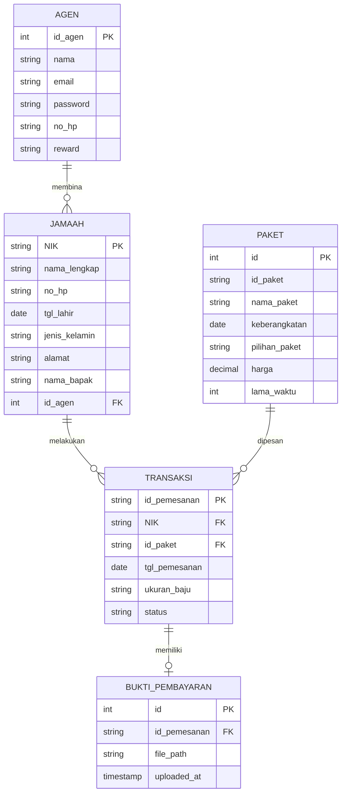

# Arsitektur Sistem & Spesifikasi API: Juragan

Dokumen ini mendokumentasikan arsitektur teknis aplikasi, pemodelan data, aliran informasi, dan spesifikasi antarmuka pemrograman aplikasi (API) yang digunakan oleh aplikasi **Juragan**.

---

## 1. Arsitektur Tingkat Tinggi (High-Level Architecture)

Aplikasi ini menggunakan pola arsitektur **Client-Server terdistribusi**:

```
+--------------------------------------------------------------------------+
|                        APLIKASI ANDROID (CLIENT)                         |
|                                                                          |
|  +--------------------+   +--------------------+   +------------------+  |
|  |     UI Layer       |   |  Networking Layer  |   | Storage Layer    |  |
|  | - Activities       |   | - Volley           |   | - SharedPrefs    |  |
|  | - Fragments        |-->| - ClientAsyncTask |-->|   ("UserData")   |  |
|  | - ViewBinding      |   | - Dexter Perms     |   | - SQLite Helper  |  |
|  | - Custom Adapters  |   |                    |   |   (Legacy)       |  |
|  +--------------------+   +--------------------+   +------------------+  |
+--------------------|-------------------|---------------------------------+
                     |                   |
                     | HTTP (POST/GET)   | HTTPS (GET)
                     v                   v
+-----------------------------+  +-----------------------------------------+
|   SERVER BACKEND JURAGAN    |  |       EXTERNAL API (BANG HASAN)         |
|  - Web Server: Apache/Nginx |  |  - Host: api.banghasan.com              |
|  - Bahasa: PHP Native       |  |  - Fitur: Jadwal Sholat & Kode Kota     |
|  - Database: MySQL          |  +-----------------------------------------+
|    (`juragandb`)            |
+-----------------------------+
```

---

## 2. Struktur Modul & Lapisan Kode

### A. Presentation Layer (UI)
- **Komponen Activity**: Digunakan untuk layar mandiri dengan siklus hidup penuh (misalnya `SplashActivity`, `LogJamaahActivity`, `panduanActivity`, `PembayaranActivity`).
- **Komponen Fragment**: Digunakan untuk konten dinamis di dalam wadah tab navigasi bawah (`MainActivity` dan `HomeAgenActivity`).
- **Layouts & ViewBinding**: Memanfaatkan kombinasi `ConstraintLayout`, `RelativeLayout`, dan `CardView` dengan ViewBinding untuk binding tampilan yang aman secara tipe.

### B. Network & Data Layer
- **Google Volley**: Menangani permintaan data format JSON (`JsonObjectRequest`) dan pengiriman form data (`StringRequest`).
- **ClientAsyncTask**: Kelas utilitas turunan `AsyncTask` yang memanfaatkan `HttpURLConnection` untuk mengunduh respon teks jadwal sholat.
- **Dexter**: Pustaka manajemen runtime permission untuk mengakses media penyimpanan saat memilih berkas bukti bayar.

### C. State & Persistence Layer
- **SharedPreferences (`"UserData"`)**: Menyimpan status autentikasi dan profil pengguna aktif:
  - `NIK` : Nomor Induk Kependudukan (String).
  - `nama_lengkap` : Nama lengkap jamaah (String).
  - `alamat`, `no_hp`, `tgl_lahir`, `jenis_kelamin`, `id_agen`, `nama_bapak`.
  - `isLoggedIn` : Status login boolean.

---

## 3. Spesifikasi API Endpoint (Backend Juragan)

Konfigurasi koneksi terpusat pada kelas [Db_Contract.java](file:///c:/Dev/Projects/Juragan/app/src/main/java/com/cadenza/bottomnavigation/API/Db_Contract.java):
- **Base Host**: `http://10.10.176.166//juragandb/`

### 1. Registrasi Jamaah
- **URL**: `urlRegjamaah` -> `/juragandb/RegJamaah.php`
- **Method**: `POST`
- **Parameter Form (POST Body)**:
  | Field | Tipe | Keterangan |
  | :--- | :--- | :--- |
  | `nama_lengkap` | String | Nama lengkap calon jamaah |
  | `NIK` | String | NIK 16 digit angka |
  | `no_hp` | String | Nomor telepon aktif |
  | `tgl_lahir` | String (Date) | Format: `yyyy-MM-dd` |
  | `jenis_kelamin` | String | `"laki-laki"` / `"perempuan"` |
  | `id_agen` | String | ID agen pembina |
  | `alamat` | String | Alamat tempat tinggal |
  | `nama_bapak` | String | Nama ayah kandung |
- **Respon Server**:
  ```json
  {
    "code": 200,
    "status": "success",
    "message": "Registrasi Berhasil"
  }
  ```

### 2. Login Jamaah
- **URL**: `urlLogjamaah` -> `/juragandb/LogJamaah.php?NIK={NIK}`
- **Method**: `POST`
- **Parameter**: Query string `NIK`
- **Respon Sukses (`code == 200`)**:
  ```json
  {
    "code": 200,
    "status": "success",
    "data_jamaah": {
      "NIK": "3509012345670001",
      "nama_lengkap": "Ahmad Abdullah",
      "alamat": "Jl. Melati No. 12",
      "no_hp": "081234567890",
      "tgl_lahir": "1990-01-01",
      "jenis_kelamin": "laki-laki",
      "id_agen": "1",
      "nama_bapak": "Abdullah"
    }
  }
  ```

### 3. Login Agen
- **URL**: `urlLogin` -> `/juragandb/login.php?email={email}&password={password}`
- **Method**: `POST`
- **Parameter**: Query parameter `email` dan `password`
- **Respon Sukses (`code == 200`)**:
  ```json
  {
    "code": 200,
    "status": "success",
    "data_agen": {
      "id_agen": "1",
      "nama": "Agen Berkah Utama",
      "email": "agen@juragan.com",
      "password": "hashed_or_plain",
      "no_hp": "081122334455",
      "reward": "Gold / 5 Jamaah"
    }
  }
  ```

### 4. Ambil Daftar Paket Travel (Shop)
- **URL**: `urlgetshop` -> `/juragandb/getShop.php`
- **Method**: `GET`
- **Respon Sukses**:
  ```json
  {
    "status": "success",
    "data_paket": [
      {
        "id": "1",
        "id_paket": "PKT-001",
        "nama_paket": "Paket Umrah Reguler",
        "keberangkatan": "2024-02-15",
        "pilihan_paket": "Quad",
        "harga": "28500000",
        "lama_waktu": "9"
      }
    ]
  }
  ```

### 5. Ambil Data Detail Agen
- **URL**: `urlgetagen` -> `/juragandb/getAgen.php?id_agen={id_agen}`
- **Method**: `GET`
- **Respon Sukses**:
  ```json
  {
    "status": "success",
    "data_agen": [
      {
        "nama": "Ust. Fulan",
        "email": "fulan@travel.com",
        "no_hp": "08123456789"
      }
    ]
  }
  ```

### 6. Transaksi Pemesanan Paket
- **URL**: `urltransaksi` -> `/juragandb/transaksi.php`
- **Method**: `POST`
- **Parameter Form (POST Body)**:
  - `tgl_pemesanan`: Format `yyyy-MM-dd`
  - `NIK`: NIK pemesan
  - `ukuran_baju`: Ukuran perlengkapan (S/M/L/XL/XXL)
  - `id_paket`: Kode paket yang dipilih
- **Respon Sukses**:
  ```json
  {
    "status": "success",
    "message": "Pemesanan berhasil dibuat",
    "data": {
      "id_pemesanan": "TRX-20240101-001"
    }
  }
  ```

### 7. Upload Bukti Pembayaran
- **URL**: `urluploadimage` -> `/juragandb/uploadImage.php`
- **Method**: `POST`
- **Parameter Form (POST Body)**:
  - `id_pemesanan`: ID transaksi yang didapat dari langkah pemesanan
  - `NIK`: NIK pemesan
  - `image`: String Base64 dari gambar bukti bayar (JPEG 100%)
- **Respon Sukses**:
  ```json
  {
    "status": "success",
    "message": "Upload gambar berhasil"
  }
  ```

---

## 4. Spesifikasi Integrasi API Publik (Jadwal Sholat)

- **Provider**: Bang Hasan Prayer API
- **Endpoint 1 (Daftar Kota)**:
  - `https://api.banghasan.com/sholat/format/json/kota/kode/semua`
  - Respon memetakan ID kota ke nama kabupaten/kota di Indonesia.
- **Endpoint 2 (Waktu Sholat Harian)**:
  - `https://api.banghasan.com/sholat/format/json/jadwal/kota/{id_kota}/tanggal/{yyyy-MM-dd}`
  - Mengambil data: Subuh, Dzuhur, Ashar, Maghrib, Isya.

---

## 5. Skema Basis Data

### A. Skema MySQL Server (`juragandb`)
Berdasarkan parameter query dan controller aplikasi, struktur tabel di database MySQL mencakup:



### B. Skema SQLite Lokal (Legacy - `DatabaseHelper.java`)
Walaupun saat ini tidak aktif digunakan, skema lokal di Android didefinisikan sebagai berikut:
- **Tabel `reg_jamaah`**: `id` (INTEGER PK AUTOINCREMENT), `full_name` (TEXT), `email` (TEXT), `nik` (TEXT), `phone` (TEXT), `gender` (TEXT), `address` (TEXT).
- **Tabel `reg_agen`**: `id` (INTEGER PK AUTOINCREMENT), `username` (TEXT), `email` (TEXT), `password` (TEXT), `phone` (TEXT).
